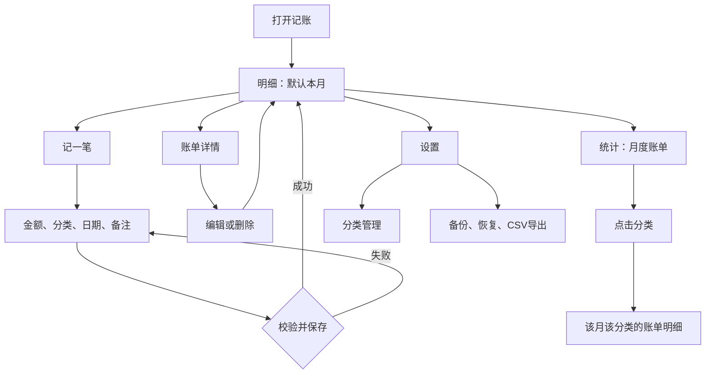

# 个人记账app｜《记账》Android 项目生成方案

版本：V1.0 方案稿  
编写日期：2026-11-02  
应用名称：**记账**  
项目目录：`个人记账app`  
交付目标：供自己安装使用的 Android 离线记账软件。

> 本文是 Android 工程的产品与开发依据。实现工程已生成于 `Jizhang`，1.0.0 签名安装包及验证结果见 `交付` 文件夹。首版围绕“快速记录消费、分类查看、回顾月度账单”完成一个完整闭环。

## 1. 产品定位与默认约定

打开就能记，花在哪里一眼看清。界面简洁、操作顺手，账单保存在自己的手机中。

| 项目 | 首版约定 |
| --- | --- |
| 使用对象 | 个人自己使用，单用户、单账本 |
| 系统 | Android；建议最低 Android 8.0 / API 26，正式生成工程前根据实际手机确认 |
| 语言与币种 | 简体中文、人民币，金额显示两位小数 |
| 记账内容 | 生活消费支出；一笔消费对应一个分类 |
| 日常运行 | 完全离线，打开、保存、查询、统计均不依赖网络 |
| 数据保存 | 手机应用私有目录中的本地数据库 |
| 安装方式 | 生成签名 APK，直接安装到自己的手机 |
| 界面方向 | 暖白底色、薄荷绿强调、大金额、清晰分类、轻量动效 |

首版聚焦支出。收入、多账本、分期、借贷、银行卡接入、支付账单自动抓取、票据识别、云同步和社交功能放在后续版本按需增加。首版也不把支出总额称为“账户余额”。

## 2. 首版功能清单

| 功能 | 具体行为 | 优先级 |
| --- | --- | --- |
| 添加消费 | 输入金额，选择分类、日期，可填写备注 | 必须 |
| 编辑消费 | 修改金额、分类、日期和备注，相关统计同步更新 | 必须 |
| 删除消费 | 在详情中删除，明确确认后移除记录 | 必须 |
| 账单明细 | 默认本月，按日期分组，展示每日合计和每笔消费 | 必须 |
| 月份切换 | 上月、下月、月份选择器及“回到本月” | 必须 |
| 分类筛选 | 在所选月份内只查看某一分类，并显示筛选合计 | 必须 |
| 月度统计 | 月消费总额、笔数、分类占比、每日消费趋势 | 必须 |
| 分类管理 | 内置分类；新增、改名、排序、归档自定义分类 | 必须 |
| 本地备份与恢复 | 完整导出账单及分类；通过备份文件恢复 | 必须 |
| CSV 导出 | 导出当前月份的消费，便于用 Excel 查看 | 必须 |
| 主题设置 | 浅色、深色、跟随系统 | 必须 |
| 连续记账 | “保存并继续”保留日期和分类，清空金额与备注 | 建议随首版完成 |
| 搜索备注 | 按关键字查找历史消费 | 后续可选 |
| 月度预算 | 设置预算并查看剩余额度 | 后续可选 |
| 指纹解锁、加密备份 | 按个人隐私需求增加 | 后续可选 |

## 3. 页面结构与使用流程

### 3.1 导航结构

底部三个入口：**明细 / 统计 / 设置**。明细和统计页面右下角固定显示“＋ 记一笔”。

“记一笔”是独立的全屏录入页，采用从底部进入的过渡，便于容纳分类和数字键盘。主导航切换保留各自的月份、筛选和滚动位置。



### 3.2 一笔消费的最短路径

1. 在明细页点“＋ 记一笔”。
2. 输入金额，例如 `28.00`。
3. 选择“餐饮”。
4. 点“保存”，返回明细页并看到刚才的记录。

日期默认今天，备注可以不填。首次录入不预选分类；以后可记住上次成功使用的有效分类，并在界面中清晰标出，随时可改。

保存期间按钮进入忙碌状态，防止重复提交；数据库确认写入成功后才退出页面。保存失败保留输入并提供重试。

### 3.3 特殊场景

- 补记上月消费：进入记账页修改日期；保存后返回原来的月份，同时提示“已记入 10 月”，提供“查看该月”入口。
- 编辑日期导致跨月：旧月份移除该笔，新月份加入该笔，两个月统计都更新。
- 从统计点分类：打开同月份、同分类的明细，返回时保留统计页状态。
- 输入尚未保存时返回：提示“继续编辑”或“放弃本次记录”。屏幕旋转和切换到后台再回来应保留草稿。
- 首次使用：直接进入空账本，显示“从第一笔消费开始”，提供记账按钮，无需注册和登录。

## 4. 界面设计方案

### 4.1 视觉规范

整体采用清爽的生活工具风格。通过留白、文字层级和局部绿色强调建立重点。

| 元素 | 设计要求 |
| --- | --- |
| 浅色背景 | 暖白 `#F6F7F5` |
| 内容卡片 | 白色 `#FFFFFF`，圆角 20dp，阴影轻微 |
| 主色 | 薄荷深绿 `#147D73`，用于主按钮、选中分类和关键图形 |
| 主文字 | `#172B29` |
| 次要文字 | `#5C6F6B`，用于日期和说明 |
| 支出金额 | 正文颜色为主，必要时以 `#B54727` 提示；始终保留负号和文字语义 |
| 数字 | 月总额 32sp，录入金额 40sp，列表金额 16sp；使用等宽数字对齐 |
| 正文 | 16sp，说明文字 14sp，随系统字体大小调整 |
| 间距 | 页面边距 20dp，卡片内边距 16dp，以 8dp 为间距基准 |
| 分类图标 | 本地矢量图标，统一笔画、统一底形，并配文字名称 |
| 动效 | 页面切换和选中反馈约 180–240ms，遵循系统减少动态效果设置 |
| 深色模式 | 独立深色背景和文字配色，逐项验证可读性 |

主要点击区域至少 48dp。适配系统导航栏、手势区域、键盘和大字体；金额与操作按钮不能被遮挡。图表同时显示名称与数值，含义不只依赖颜色。

### 4.2 明细页：首页

顶部月份切换，中间展示本月消费摘要，下方展示按天分组的明细。“记一笔”始终容易找到。

```text
┌──────────────────────────────┐
│ 记账                         │
│ ‹        2026年11月        › │
│                              │
│ 本月支出                     │
│ ¥ 368.50                     │
│ 共 8 笔          今日 ¥46.00 │
│                              │
│ [全部分类 ▾]                 │
│                              │
│ 今天 · 11月2日       ¥46.00 │
│ 餐饮  午餐             -28.00│
│ 餐饮  咖啡             -16.00│
│ 交通  公交              -2.00│
│                              │
│ 昨天 · 11月1日      ¥322.50 │
│ 购物  超市采购        -128.50│
│ 交通  打车             -24.00│
│ …                            │
│                  [＋ 记一笔] │
│                              │
│   明细       统计       设置 │
└──────────────────────────────┘
```

- 每笔消费左侧为分类图标，中间为备注和分类，右侧金额对齐；备注为空时以分类名为主标题。
- 日期从新到旧；同日记录按创建时间从新到旧，使用 ID 作为稳定的次级排序。
- 切换月份时列表与摘要一起更新；临时加载中不展示旧月份的金额。
- 分类筛选后保留“本月总支出”，另显示“餐饮合计 ¥86.00 · 3 笔”；每日小计也按筛选结果计算，避免混淆。
- 点击记录进入详情。编辑与删除入口放在详情页中。

### 4.3 添加消费页

大金额在上，分类在中，数字键盘和保存按钮在下。先输入金额，再选分类，单手即可完成常用操作。

```text
┌──────────────────────────────┐
│ ‹           记一笔           │
│                              │
│ 支出金额                     │
│ ¥ 28.00                      │
│                              │
│ 餐饮✓   交通    购物    居住 │
│ 日用    娱乐    医疗    学习 │
│ 通信    人情    旅行    其他 │
│                              │
│ 日期    今天 · 11月2日    ›  │
│ 备注    午餐                 │
│                              │
│    1        2        3       │
│    4        5        6       │
│    7        8        9       │
│    .        0        ⌫       │
│                              │
│ [保存并继续]       [ 保存 ]  │
└──────────────────────────────┘
```

默认显示金额数字键盘。编辑备注时切换为系统文字键盘；点击金额区返回数字键盘，两种键盘不同时占据页面。金额控件保留可访问的文本编辑能力，支持粘贴和读屏输入。

表单规则：

- 金额必须大于零，最多两位小数；最多允许 `9,999,999.99` 元。
- `0.01` 有效；零、负数、超限金额和超过两位小数的粘贴内容需明确提示，不静默取整。
- 分类必须有效且未归档；金额为空或分类未选时，保存按钮不可用。
- 日期按消费发生的自然日选择；首版不允许未来日期。
- 备注选填，最多 100 个字符，去掉首尾空白。
- “保存并继续”仅在保存成功后清空金额和备注，保留日期与分类；返回时不重复写入。

### 4.4 统计页：月内账单

```text
┌──────────────────────────────┐
│ 月度账单                     │
│ ‹        2026年11月        › │
│                              │
│ 本月支出 ¥368.50    共8笔    │
│                              │
│ 消费分类                     │
│       分类占比环形图         │
│                              │
│ 购物   ¥196.50        53.32%│
│ 餐饮    ¥86.00        23.34%│
│ 通信    ¥60.00        16.28%│
│ 交通    ¥26.00         7.06%│
│                              │
│ 每日消费                     │
│       按日支出柱状图         │
│                              │
│ [导出本月CSV]                │
│   明细       统计       设置 │
└──────────────────────────────┘
```

月度统计包括：

1. 当前所选月份的支出总额、总笔数。
2. 分类消费金额与占比，按金额从高到低排列；同金额按分类排序值排列。
3. 每日支出趋势，缺少消费的日期补零；本月绘制至今天，历史月绘制整月。
4. 点击分类查看对应明细；点击某天查看当日明细。

超过 5 个有消费分类时，环形图可显示金额前 5 名及“其余分类”汇总；下方仍列出全部分类。“其余分类”只是图表汇总名称，与内置“其他”分类分开。

无消费月份显示“这个月还没有记录”和记账入口，不显示示例金额，不计算零分母占比。占比显示两位小数，允许因四舍五入导致合计略有偏差。

### 4.5 设置页

只保留常用项目：分类管理、导出备份、从备份恢复、CSV 导出、主题模式、关于记账。

备份区域显示最近一次成功导出时间，并说明“卸载应用或清除应用数据会删除手机中的账本，请先导出备份”。该说明放在备份和关于页面，不反复打断记账。

## 5. 消费分类方案

### 5.1 内置分类

| 分类 | 典型消费 |
| --- | --- |
| 餐饮 | 早餐、午餐、晚餐、外卖、咖啡、零食 |
| 交通 | 公交、地铁、打车、停车、加油 |
| 购物 | 衣服、数码产品、综合购物采购 |
| 居住 | 房租、水费、电费、燃气、物业 |
| 日用 | 清洁用品、纸巾等日常耗用品 |
| 娱乐 | 电影、游戏、会员、休闲活动 |
| 医疗 | 买药、挂号、体检、就诊 |
| 学习 | 书籍、课程、培训、文具 |
| 通信 | 手机话费、宽带 |
| 人情 | 礼物、红包、聚会份子钱 |
| 旅行 | 住宿、门票、旅游相关支出 |
| 其他 | 暂时不适合其他分类的消费 |

分类以个人习惯为准，应用不强制推断。例如超市购物可归购物，专门买清洁用品可归日用；首版一笔只选择一个分类。

### 5.2 分类管理规则

- 自定义分类需填写名称，选择本地图标和预设颜色，可调整排序。
- 名称去掉首尾空白后为 1–8 个字符；已有分类名称不能重复，包括归档分类。
- 分类 ID 永久稳定。改名后历史账单按新名称展示，金额不受影响。
- 被账单引用的分类只能归档，历史账单、筛选和统计仍然保留；归档分类不再出现在新建消费的选择区。
- 编辑历史记录时可以保留原本已归档的分类，也可以改为其他有效分类。
- 没有被引用的自定义分类可删除；数据库外键阻止误删有历史记录的分类。
- 内置“其他”保留为可用兜底分类。首版不提供分类合并功能。

## 6. 技术实现方案

### 6.1 推荐技术组合

采用 Android 原生方案，适合单一 Android 平台和本机离线使用。

| 层面 | 选择 | 用途 |
| --- | --- | --- |
| 开发语言 | Kotlin | 编写界面与业务逻辑 |
| 界面 | Jetpack Compose + Material 3 | 生成原生页面、主题和交互组件 |
| 页面状态 | ViewModel + StateFlow | 管理加载、表单和账单状态 |
| 页面导航 | Navigation Compose | 三个主页面、录入页和详情页之间导航 |
| 本地数据库 | Room / SQLite | 持久保存消费与分类 |
| 偏好设置 | Preferences DataStore | 保存主题、上次使用的分类等轻量设置 |
| 异步任务 | Kotlin Coroutines + Flow | 数据库操作、统计和文件读写 |
| 序列化 | kotlinx.serialization | 结构化备份的读写与校验 |
| 文件选择 | Android Storage Access Framework | 用户选择备份导出位置和恢复文件 |
| 图表 | Compose Canvas | 绘制简单环形图和每日柱状图，同时提供文本数据 |
| 工程构建 | Gradle Kotlin DSL + Version Catalog + KSP | 统一管理版本及数据库代码生成 |

这一组合参考 Android 官方的 [Compose 与分层架构建议](https://developer.android.com/topic/architecture/recommendations)、[Room 本地存储说明](https://developer.android.com/training/data-storage/room) 和 [DataStore 说明](https://developer.android.com/topic/libraries/architecture/datastore)。表中具体选型是本项目的建议。

### 6.2 项目规模与数据流

首版只建立一个 `app` 模块，按功能分包，使用一个简单的依赖容器。页面通过 ViewModel 和 Repository 访问数据。

```text
Compose 页面
    ↓ 用户操作              ↑ 页面状态
ViewModel / StateFlow
    ↓                      ↑
Repository：校验、保存、聚合、备份编排
    ↓                      ↑
Room 数据库        DataStore 偏好设置
```

数据库是账单数据的唯一事实来源。新增、编辑、删除后由数据库 Flow 驱动明细和统计刷新，避免在多个页面分别累加总额。数据库与文件读写离开主线程，页面按生命周期收集状态。

应用运行不声明 `INTERNET` 权限，不接入登录、广告、统计分析或远程崩溃上报 SDK。图标和必要资源随 APK 打包。

“离线”指安装后的使用。首次准备 Android SDK、下载依赖和构建工程通常需要开发电脑联网；后续离线构建需要先备齐依赖。

### 6.3 生成工程前的版本规则

使用生成工程时核实过的稳定版本，在 `gradle/libs.versions.toml` 中锁定 Kotlin、Compose BOM、Room、KSP、导航及 DataStore 的确切版本。不要使用 `+` 动态版本，也不要混用不同 Room 主版本的依赖坐标和 API。

`compileSdk`、`targetSdk`、Gradle、Android Gradle Plugin 和 JDK 选择互相兼容的稳定组合，并在 README 记录。当前方案不把尚未验证的版本号写成可构建承诺。

## 7. 本地数据设计与统计规则

### 7.1 消费表 `expense_records`

| 字段 | 建议类型 | 说明 |
| --- | --- | --- |
| id | String / UUID | 主键；创建草稿时生成一次，提交重试沿用，防止重复入账 |
| amountFen | Long | 金额，单位分，必须大于 0 |
| categoryId | String | 分类外键，禁止级联删除账单 |
| expenseDate | String | 消费自然日，固定 `yyyy-MM-dd` |
| note | String | 备注，默认空字符串 |
| createdAt | Long | 创建时间，UTC 毫秒 |
| updatedAt | Long | 最后修改时间，UTC 毫秒 |

建立日期索引和 `(categoryId, expenseDate)` 组合索引。金额用整数分存储和求和，输入通过十进制字符串或 BigDecimal 精确转换，禁止用 Float/Double 保存金额。

### 7.2 分类表 `categories`

| 字段 | 建议类型 | 说明 |
| --- | --- | --- |
| id | String | 稳定主键，内置分类使用固定 ID |
| name | String | 唯一分类名 |
| iconKey | String | 本地图标标识 |
| colorKey | String | 预设颜色标识 |
| sortOrder | Int | 展示排序 |
| isBuiltIn | Boolean | 是否为内置分类 |
| isArchived | Boolean | 是否已归档 |

首次建库时在事务中写入内置分类。历史已归档分类始终可查询；名称、图标和颜色改变后历史记录使用当前分类样式。

### 7.3 统计口径

- 月份范围为该月 1 日（包含）到下月 1 日（不包含）。例如 2026 年 11 月是 `[2026-11-01, 2026-12-01)`。
- 月总额：范围内所有消费的 `amountFen` 之和；分类总额与日总额使用同一套范围规则。
- 分类占比：分类总额 ÷ 月总额 × 100%；只有显示比例时才进行小数舍入。
- `expenseDate` 表示用户选择的本地自然日；更换时区不会把已有消费移动到其他日期。
- 创建时间用于排序和审计，不用来决定消费所属月份。
- 首版不录入负数退款。需要退款管理时另行设计退款记录及净支出规则，不能用负数金额绕过校验。
- 新增、修改、删除及恢复必须维护外键和事务一致性。正式账本不使用破坏性迁移自动清空数据。

## 8. 备份、恢复与导出

### 8.1 完整备份

建议文件名：`记账备份_20261102_203000.jizhang.json`。这是明文 JSON 备份，首版需在导出页注明文件包含消费信息。

内容包含：备份格式版本、应用版本、导出时间、全部分类（含归档分类）、全部消费、记录数量。界面主题、临时草稿等设备偏好不纳入账本备份。

通过一次一致的数据库读取事务获取分类和记录快照，再在后台序列化。不要直接复制正在使用的 SQLite 数据库文件，以免遗漏尚在 WAL 中的数据。

导出使用系统文件选择器，用户明确选择位置。建议选择手机本地文件夹或移动存储；系统选择器可能展示第三方云盘，应用本身不主动上传。完整写入、关闭文件并确认成功后，才更新“最近备份时间”。取消或写入失败不报成功。

系统文件选择器可让用户选择文件而无需授予广泛存储权限，参见 [Android 文件访问说明](https://developer.android.com/training/data-storage/shared/documents-files)。

### 8.2 恢复流程

1. 选择备份文件并在后台读取，设置合理文件大小上限（首版建议 50MB）。
2. 校验格式版本、字段类型、金额范围、日期、重复 ID、分类外键和记录数量；未知版本拒绝恢复。
3. 显示“备份时间、消费笔数、分类数量、消费总额、日期范围”，便于确认文件内容。
4. 明确提示“恢复将替换当前全部账单和分类”；首版只支持完整替换。
5. 用户确认后，先在应用私有目录保留恢复前快照；快照失败则不开始替换。
6. 在一个数据库写事务内替换分类和记录，并暂停录入。失败则回滚，当前账本保持原状。
7. 成功后刷新全部页面；保留“撤销上次恢复”入口，直到下一次恢复替换该快照。

恢复前快照仅用于误操作撤回，不代替导出到应用之外的备份。导入应使用原有记录 ID，同一备份反复恢复不会新增重复消费。

### 8.3 CSV 导出

当前月份导出全部分类的消费，文件名如 `记账_2026-11.csv`，使用 UTF-8 BOM。列为：消费日期、分类、金额（元）、备注、创建时间。

金额使用两位小数的正数文本，表头明确其为支出。按 CSV 规则处理逗号、引号和换行，对用户文本中的公式起始字符进行转义，避免在电子表格中被作为公式运行。

CSV 用于查看和整理，首版不将 CSV 作为恢复入口；完整恢复使用包含分类 ID 和格式版本的 JSON 备份。

### 8.4 系统备份约定

如果严格要求账本留在本机，应关闭应用系统自动云备份，并为相应 Android 版本配置备份排除规则。Android 12 及以上还需配置云备份与设备迁移的排除项；部分厂商的迁移行为不能仅靠 `allowBackup=false` 推断，需在实际手机上验证。依据见 [Android Auto Backup 文档](https://developer.android.com/identity/data/autobackup) 和 [Android 12 备份行为说明](https://developer.android.com/about/versions/12/behavior-changes-12)。

## 9. Android 项目生成结构

文件夹名称使用中文方便识别；Gradle 项目与包名使用英文，减少工具兼容问题。

建议工程名：`Jizhang`；初始包名：`com.personal.jizhang`；桌面显示名称：`记账`。包名需在首次正式安装前固定，后续覆盖升级保持一致。

```text
个人记账app/
├── 个人记账app.md                # 本方案
└── Jizhang/                     # 下一阶段生成的 Android 工程
    ├── README.md                # 环境、构建、安装和数据说明
    ├── settings.gradle.kts
    ├── build.gradle.kts
    ├── gradle.properties
    ├── gradlew
    ├── gradlew.bat
    ├── gradle/
    │   ├── libs.versions.toml
    │   └── wrapper/             # Wrapper jar 与版本配置
    └── app/
        ├── build.gradle.kts
        ├── schemas/            # Room 数据库版本快照
        └── src/
            ├── main/
            │   ├── AndroidManifest.xml
            │   ├── java/com/personal/jizhang/
            │   │   ├── JizhangApplication.kt
            │   │   ├── MainActivity.kt
            │   │   ├── di/AppContainer.kt
            │   │   ├── data/
            │   │   │   ├── local/        # Entity、DAO、Database、Migration
            │   │   │   ├── repository/   # 消费、分类、统计
            │   │   │   ├── backup/       # 备份与原子恢复
            │   │   │   └── preferences/  # DataStore
            │   │   ├── model/           # 页面模型、月份和统计结果
            │   │   ├── ui/
            │   │   │   ├── navigation/
            │   │   │   ├── theme/
            │   │   │   ├── components/
            │   │   │   ├── ledger/
            │   │   │   ├── editor/
            │   │   │   ├── detail/
            │   │   │   ├── statistics/
            │   │   │   ├── categories/
            │   │   │   └── settings/
            │   │   └── util/            # 金额、日期、CSV 格式化
            │   └── res/                 # 中文文本、矢量图标、备份规则
            ├── test/                    # 金额与统计等单元测试
            └── androidTest/             # 数据库、恢复与关键界面测试
```

目录示例表示下一阶段应生成的文件，并不表示这些文件已经存在。

## 10. 分阶段生成与开发顺序

### 阶段一：生成可运行基础工程

建立 Kotlin + Compose 工程，配置应用名称、图标、主题、版本目录和三个主页面；生成 Gradle Wrapper，先完成一次构建及手机安装。此时首页为空账本，不把演示数据写入正式数据库。

验收：手机桌面显示“记账”，打开后能在三个主页面切换，飞行模式下正常启动。

### 阶段二：打通真实记账闭环

实现数据库、内置分类、消费录入、详情、编辑、删除及分类管理。处理输入校验、日期、草稿、重复提交和错误恢复。

验收：新建一笔消费后重启应用仍可查看；修改或删除后列表和合计准确更新。

### 阶段三：完成月度账单与界面细化

实现月份切换、分类筛选、月度聚合、环形图与日趋势图；完成浅深主题、空状态、点击反馈、大字体和键盘适配。

验收：能回看任意已有消费月份，并从统计进入对应分类或日期的明细。

### 阶段四：完成数据带走与恢复

实现 JSON 备份、完整恢复、恢复前快照、CSV 导出和系统备份排除规则。

验收：先在测试设备导出备份，清空测试账本，再恢复；记录、分类和金额完全一致。文件损坏或取消操作时，原账本不变。

### 阶段五：真机检查与个人发布

在实际使用手机上完成离线、长列表和升级验证。生成签名 Release APK，记录版本和安装步骤。

验收：同包名、同签名的新版本可覆盖安装，既有消费保留；APK 无不必要的网络或广泛存储权限。

首版交付内容应包含：完整源码、可安装签名 APK、构建说明、简短使用说明、备份恢复说明和测试结果。签名密钥由本人独立妥善保存，不写入源码仓库；后续覆盖升级继续使用同一密钥。

## 11. 验收用例与性能目标

### 11.1 必测的业务场景

| 场景 | 预期结果 |
| --- | --- |
| 飞行模式下新建、编辑、删除、查看和导出 | 日常功能正常运行，无联网等待 |
| 输入 0、负数、三位小数和超限金额 | 阻止保存并给出具体提示 |
| 连续点两次保存或失败后重试 | 只产生一笔消费 |
| `0.10 + 0.20`、大量小额消费求和 | 精确得到 `0.30`，无浮点金额误差 |
| 12 月 31 日、1 月 1 日、闰年 2 月 29 日 | 归入正确月份，边界记录不遗漏、不重复 |
| 编辑消费从上月移到本月 | 两个月份的金额、笔数与图表同步更新 |
| 无消费月份 | 总额为零，显示空状态，图表不报错 |
| 分类改名、归档、删除 | 历史记录保留，被引用分类不被误删 |
| 重启、旋转屏幕、后台返回 | 已保存数据存在，未提交输入尽量保留，不自动重复提交 |
| 恢复损坏文件、未知版本或无效分类引用 | 拒绝恢复，当前数据不变 |
| 备份往返恢复 | IDs、分类、日期、备注、整数金额和总笔数一致 |
| 中途取消导出、磁盘空间不足或写入失败 | 不显示成功，不修改最近成功备份时间 |
| 更新安装新版本 | 正确执行数据库迁移，保留原账本 |
| 深色、大字体、320dp 窄屏、手势导航 | 金额和按钮可见，内容不重叠，输入不被键盘挡住 |

测试聚焦金额、月份边界、数据库外键、迁移和备份恢复；关键界面验证从“记一笔”到回看消费的完整操作路径。

### 11.2 可量化目标

以实际自用手机为验收设备，用 10,000 笔本地记录验证：

- 冷启动进入可操作首页目标不超过 2 秒。
- 常规保存到明细更新目标不超过 300ms。
- 月份切换目标不超过 500ms，滚动无明显持续卡顿。
- 备份和恢复在后台处理，过程中显示进度，页面不冻结。

以上是开发目标，需实机测量。记录手机型号、系统版本和数据量后给出结果，不把目标当作已经完成的性能指标。

## 12. 方案确定后的生成任务说明

后续开发可直接按以下任务执行：

> 在 `个人记账app/Jizhang` 中生成 Android 原生工程，应用名“记账”，使用 Kotlin、Jetpack Compose、Material 3、Room、DataStore 和 Coroutines。按本方案依次完成明细、消费录入、详情编辑、分类管理、月度统计和本地备份恢复。所有正式账单由 Room 持久保存，金额使用整数分，消费日期使用固定自然日；应用无需登录，无网络依赖。采用暖白与薄荷绿视觉，支持浅深主题。先生成能构建安装的基础工程，再按阶段实现真实功能；正式数据库不预置演示消费。最终交付可覆盖升级的签名 APK、源码、使用说明与实测结果。

首版完成的判断标准：**能快速记下真实消费，准确查看每月花在哪里，并能把账本完整备份和恢复。**
